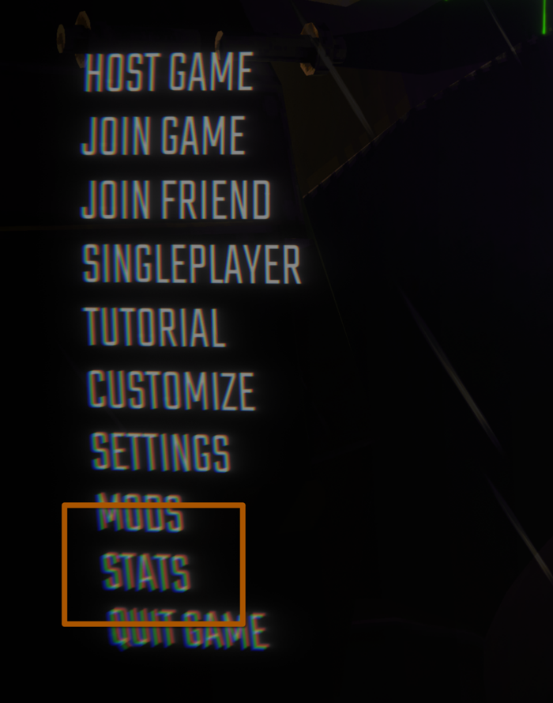
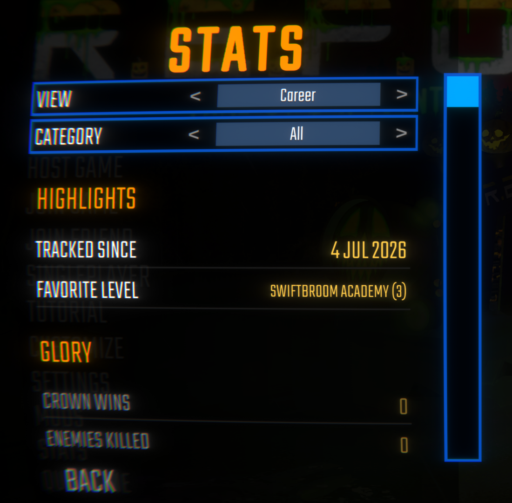

# StatsCore

Everything R.E.P.O. keeps about you, on one screen. Open **Stats** from the main menu or the pause menu and see your career, today, the last 7 days and the run you are on, sorted into groups like a character sheet. Under the screen is a stat-tracking library other mods build on.

> **A note from Vippy**
>
> After way too long of a break, I'm finally back and working on these again :D Every one of my mods just got a full pass: bugs fixed, reports read, a few things I'd always meant to do. New builds and fixes land in [Vippy's Discord](https://discord.gg/kKqhck2NrP) before they hit Thunderstore, so come hang out. Thanks for sticking around.

## The stats screen





Pick a view at the top: **Career**, **Today**, **Last 7 days** or **This run**. Narrow it to one category if you want, or leave it on All. Every stat gets a row with its value, grouped the way a character sheet would: Glory, Mobility, Expeditions, Misfortune, Recovery, Mischief. Time, distance and money are shown the way you would say them, so 11,220 seconds reads as 3h 07m and 12,400 meters as 12.4 km.

Deaths by Enemy, Damage by Enemy and Map Visits open into a top list. Career starts with a Highlights block: when StatsCore started recording, the enemy that has killed you most and the level you land on most.

It shows every stat any mod registers through StatsCore, so another mod's numbers appear on their own. If that mod gave the stat a name and category with `Describe`, it lands in the right group. If not, it still shows under Other.

Both menu buttons can be switched off under Stats screen in the config. The screen uses MenuLib, so mod managers install that alongside StatsCore. Without MenuLib everything is still tracked, you just don't get the screen.

## For mod authors

StatsCore is also a library. On its own it quietly records the built-in pack; its real job is to be a dependency for other mods. A drinking-game mod, an end-of-run scoreboard, a "reward the unluckiest Semibot" mod: all of them just call into StatsCore instead of reinventing the bookkeeping. Anything you define shows up on the stats screen for free.

## Install

Drop `StatsCore.dll` into `BepInEx/plugins`. It needs BepInEx, plus MenuLib for the stats screen. If you use a mod manager, add it as a dependency of your mod and the manager handles the rest.

## Quick start

```csharp
using StatsCore;

// Define once (e.g. in your plugin's Awake). Key convention: "author.modname.stat".
var drinks = Stats.Define("vippy.pourdecisions.drinks", StatScope.PerPlayer, StatLifetime.Career)
                  .Describe("Drinks", "Sips taken this career.", category: "Party")
                  .TrackDaily();

// Write. For Career this always lands locally; for synced lifetimes only the host's write lands.
drinks.Add(steamID, 1);

// Read.
int total = drinks.Get(steamID);
int today = drinks.GetToday(steamID);
int thisWeek = drinks.GetLastDays(steamID, 7);
```

Another mod can read your stat by its key without referencing your assembly:

```csharp
int n = Stats.Get("vippy.pourdecisions.drinks")?.Get(steamID) ?? 0;
```

## Scopes and lifetimes

A stat has a **scope** (who it's tracked for) and a **lifetime** (when it resets and whether it persists).

| `StatScope` | meaning |
|---|---|
| `PerPlayer` | one value per steamID |
| `Team` | a single shared value (use `GetTeam` / `SetTeam` / `AddTeam`) |

| `StatLifetime` | resets | synced? | persists? |
|---|---|---|---|
| `Level` | every scene / level transition | yes (host-authoritative) | no |
| `Run` | when a new run starts (back at the lobby menu) | yes (host-authoritative) | no |
| `Session` | never until the game closes | yes (host-authoritative) | no |
| `Career` | never | no (local to each machine) | yes, to disk |

The Run reset correctly distinguishes the truck "lobby" between levels (Run stats survive) from the real lobby menu that starts a fresh run (Run stats clear). That distinction is the thing most mods get wrong.

## The sync model

Synced stats (Level, Run, Session) flow one of two ways. Career stats stay local to each machine.

### Host-authoritative (default)

The host owns the value. Call `Add`/`Set` from host-gated code; it replicates to every client running StatsCore, and late joiners receive a full snapshot the moment they enter the room. A write on a client is dropped with a debug log, so gate your writes:

```csharp
if (Stats.IsHost) myStat.Add(steamID, 1);   // true on the host, or in singleplayer/offline
```

### Client-authoritative (push)

When the *client* is the one that knows the value, mark the stat `ClientAuthoritative()`. Each client owns its own player's slot and pushes changes to everyone, the host included. No host gate, and no client can write another player's slot (spoofed writes are rejected on receipt). This is the clean way to feed a host-side aggregate from per-client counters:

```csharp
// every client, defined the same way
var sips = Stats.Define("vippy.pourdecisions.drinks", StatScope.PerPlayer, StatLifetime.Session)
                .ClientAuthoritative();
sips.Add(localSteamID, 1);          // your own slot; lands on every machine
int crewTotal = sips.Sum();         // the host (and everyone) sees the whole crew
```

### Host-pull (request)

To pull a value that isn't synced continuously, including **Career / local-only** stats, the host can ask every client for its local value of a key. Each client answers for its own player; the host collects the replies (its own included) and gets a `steamID -> value` map when all reply or the timeout elapses:

```csharp
// host only; off-host it answers immediately with just the local value
Stats.RequestFromClients(GameStats.K_Deaths, byPlayer =>
{
    foreach (var kv in byPlayer) Log($"{kv.Key}: {kv.Value} career deaths");
}, timeoutSeconds: 3f);
```

This is how an end-of-run scoreboard gathers everyone's career numbers without each client having to publish them all the time.

### Career is local

Career stats are **local** to each machine. Every player keeps their own record on disk; nothing about Career touches the network except when the host explicitly pulls it. The built-in hooks fire on all clients, but each machine only records its own local Semibot, which keeps a clean per-player history.

## Persistence and querying by day

Career stats are written to a `StatsCore` folder in the game's own per-user data folder (the one the game keeps your settings in), as `career.txt` (debounced, atomic write-then-swap, with first/last timestamps). You get the totals back automatically the moment you `Define` a Career stat. The swap keeps the version it replaced as `career.txt.bak`, and a file that has gone unreadable is loaded from that instead.

Rows belonging to a stat nobody defined this session are copied through on every save, so uninstalling a mod for an evening doesn't erase the career numbers it owns.

That folder is shared by every mod manager profile, so your career is one record no matter which profile you play from. Versions before 1.0.0 kept a separate file inside each profile; the first time a profile runs 1.0.0 its old file is added into the shared one (totals and daily history summed) and renamed to `career.txt.migrated`, so nothing is counted twice.

Opt a Career stat into per-day history with `.TrackDaily()`. Each change is bucketed by the machine's local calendar day, persisted to `career-daily.txt`, and queryable:

```csharp
stat.GetToday(steamID);                      // gained today
stat.GetOnDay(steamID, someDate);            // gained on one date
stat.GetRange(steamID, fromDate, toDate);    // gained across a date range (inclusive)
stat.GetLastDays(steamID, 7);                // gained over the last 7 days, today included
stat.DailyHistory(steamID);                  // every day on record, oldest first
```

Buckets store the *change* on each day, so a range sum always reconciles to the running total. Days are local, not UTC: a career stat belongs to one player on one PC, so "today" means their today rather than rolling over mid-evening. Only the date part of a `DateTime` is read, and a UTC one is converted first, so `DateTime.Today` and `DateTime.UtcNow` both land on the right bucket.

Daily history is opt-in because it grows the save file; leave it off for stats you'll only ever read as a lifetime total.

## Timestamps and milestones

Every stat stamps when each player's value was first recorded and last changed:

```csharp
DateTime? first = stat.FirstRecorded(steamID);
DateTime? last  = stat.LastUpdated(steamID);
```

Fire a one-shot callback the first time a value crosses a threshold (fires immediately if a freshly-hydrated Career stat is already past it):

```csharp
stat.OnReach(steamID, 100, () => GiveReward(steamID));
```

A threshold that never gets reached keeps its handler subscribed for the rest of the session, so register milestones once at startup rather than per player per run.

React to any change with `stat.Changed` (one stat) or `Stats.AnyChanged` (every stat, a firehose handy for an overlay).

## Trackers: binding a stat to game state

You usually don't write your own loop. A `Tracker` binds a stat to a vanilla value in one place, so a game update is a one-line fix and a removed member just disables that tracker (logged) instead of crashing.

```csharp
// HOOK - event-driven, zero per-frame cost, fires when a vanilla method runs.
Trackers.Hook(doors, typeof(PhysGrabObject), "GrabStarted",
    (s, inst, args) => s.Add(SteamIdOf(inst), 1), new[] { typeof(PhysGrabber) });

// MIRROR - read a value the game already keeps, sampled at lifecycle points (no per-frame cost).
Trackers.Mirror(haul, () => StatsManager.instance.GetRunStatTotalHaul(), SampleWhen.Tick);
Trackers.MirrorPlayers(health, p => p.playerHealth.health);
```

`SampleWhen` is `LevelChange`, `RunReset`, or `Tick` (a slow ~3s poll that only runs if some mirror asks for it). A mirror on a synced stat is a host-side thing: clients skip sampling it, since their write would be dropped anyway.

## Built-in GameStats pack

Defined at boot, filled from vanilla events, free to read by any mod. Each is per-player and Career (persisted, local) unless noted. Read by handle (`GameStats.Deaths`) or by stable key (`GameStats.K_Deaths`).

| Category | Stats |
|---|---|
| Misfortune | Deaths (+ per-enemy breakdown), Knockdowns, Spewer Faces, Damage Taken (+ per-enemy breakdown), Hits Taken |
| Recovery | Revives, Health Healed |
| Glory | Crown Wins, Enemies Killed |
| Mobility | Distance Traveled / Walking / Sprinting (meters), Objects Grabbed |
| Mischief | Friendly Fire, Teammates Killed, Betrayal Taken |
| Expeditions | Map Visits (keyed by level name) |
| Expedition (live, synced team mirrors) | Run Level, Run Currency, Total Haul |

The per-enemy breakdowns are keyed by enemy display name rather than steamID, so `GameStats.DamageTakenByEnemy.Get("Loom")` tells you exactly how hard a given enemy has clapped you over your career. Distance is stored in meters; a display can convert to whatever unit it likes (the `StatFormat.Distance` hint marks it).

```csharp
int crowns = GameStats.CrownWins.Get(steamID);
int milesByLoom = GameStats.DamageTakenByEnemy.Get("Loom");
int ranToday = GameStats.DistanceSprinting.GetToday(steamID);
```

## A note on enemy names

Anything keyed by enemy name resolves through the game's own `enemyName`, so it always matches whatever the current build calls a given enemy, including ones added after this library shipped. Community nicknames (like "Loom") only match if that's the in-game name; otherwise read the name the game uses.

Names are slot keys, and slot keys frame both the save file and the sync wire format, so `| = ; , :` and whitespace controls are folded to `_` on the way in. An enemy a content mod calls `Slow=Mouth` reads back as `Slow_Mouth`. Ordinary names are untouched.

## Come hang out

I'm Vippy. I make R.E.P.O. mods and I read every bug report.

| | |
|---|---|
| **[Vippy's Discord](https://discord.gg/kKqhck2NrP)** | Test builds land here before Thunderstore, you get a say in what comes next, and it's the fastest way to get a bug fixed. Come say hi. |
| **[GitHub Issues](https://github.com/VirtualPixel/StatsCore/issues)** | Bug reports and ideas that deserve a paper trail. |
| **[R.E.P.O. Modding Server](https://discord.gg/9fDzZ9sk95)** | The whole modding scene, not just me. |
| **[More of my mods](https://thunderstore.io/c/repo/p/Vippy/)** | Everything else I've made for R.E.P.O. |

## Keep the mods coming

Everything I make is free and stays free. Two ways to help if you feel like it, neither one expected:

- **[Ko-fi](https://ko-fi.com/vippydev)**: buy me a coffee and your name goes on the supporters list in my Discord. Every coffee buys another evening on the next update.
- **[BisectHosting](https://bisecthosting.com/vippy)**: hosting a server for Minecraft or anything else your crew plays? Code `vippy` takes 25% off, and I get a cut at no cost to you. It's where my own servers live.

[](https://bisecthosting.com/vippy)
